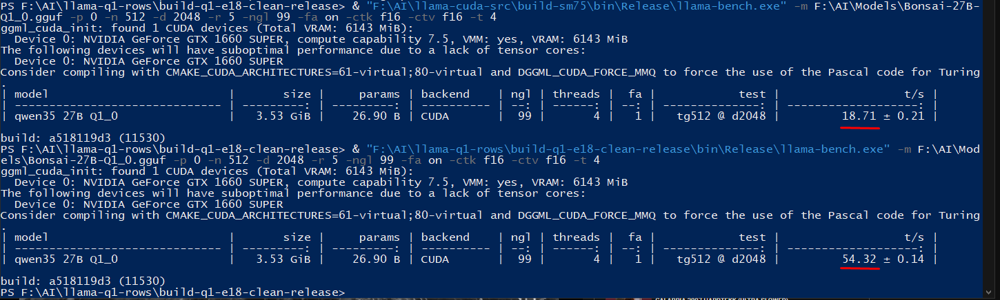

# Bonsai-27B (1-bit) on a GTX 1660 SUPER: 19 -> 56 tok/s

Unofficial CUDA patch for [llama.cpp](https://github.com/ggml-org/llama.cpp) `a518119d3`, not affiliated with the llama.cpp project. It makes 1-bit `Q1_0` models like Bonsai-27B generate text about **3x faster** on Turing GPUs (GTX 16xx / RTX 20xx). The model and its answers stay the same: only the GPU code that does the math is faster.

Windows build: see [Releases](https://github.com/pinkmanwest/llama-q1-turing/releases). All code changes: [q1-turing.patch](q1-turing.patch).

## Results

| llama-bench tg512 @ depth 2048, GTX 1660 SUPER, Windows 10, CUDA 12.8 | tok/s |
|---|---:|
| stock llama.cpp a518119d3 | 19.0 |
| patched | 56.6 |

Measured A-B-B-A in one session (`llama-bench -p 0 -n 512 -d 2048 -r 5 -ngl 99 -fa on -ctk f16 -ctv f16 -t 4`): stock 18.39 +- 0.65, patched 56.47 +- 0.67, patched 56.74 +- 0.18, stock 19.71 +- 0.05 tok/s.

Another run of the same command, one per build (stock 18.71, patched 54.32 tok/s):



## What is Q1_0 and Bonsai-27B?

- **Quantization** stores model weights with fewer bits so the model needs less memory. Common formats use 4-8 bits per weight.
- **Q1_0 is 1-bit**: every weight is just **+1 or -1**, and each group of 128 weights shares one scale number. That is about 1.1 bits per weight.
- So a 27-billion-parameter model is only **3.53 GB**, small enough for a 6 GB gaming GPU. At 4 bits the same model needs about 16 GB.
- **Bonsai-27B** (by PrismML, based on Qwen3.5-27B) is made to work at 1 bit. If you squeeze an ordinary model to 1 bit, it gets much worse. Bonsai does not have this problem.
- Stock llama.cpp runs Q1_0 slowly on older GPUs. This patch adds GPU code written for this format and for Turing cards.

## Which GPUs?

The speedup works only on **Turing** GPUs (CUDA compute capability 7.5):

| GPU | Works | Notes |
|---|---|---|
| GTX 1660, 1660 SUPER, 1660 Ti (6 GB) | yes | tested on GTX 1660 SUPER |
| RTX 2060, 2060 SUPER, 2070, 2070 SUPER, 2080, 2080 SUPER, 2080 Ti, Titan RTX | should work | not tested; likely faster (more memory bandwidth) |
| Laptop GTX 16xx / RTX 20xx with 6 GB+ | should work | not tested |
| Quadro RTX, Tesla T4 | should work | not tested |
| GTX 1650 / 1650 SUPER, MX450 (4 GB or less) | no | the model does not fit in 4 GB |
| GTX 10xx and older (Pascal) | no | the Windows build has no code for these GPUs |
| RTX 30xx / 40xx / 50xx | no speedup | may start, but runs at stock speed; use official llama.cpp |

You need **at least 6 GB of video memory**.

## Quick start (Windows)

Requirements:

- Windows 10 or 11, 64-bit
- NVIDIA driver **570 or newer**. Check: run `nvidia-smi` in a terminal and look at "Driver Version". Update at nvidia.com if it is older.
- CPU with AVX2 (any Intel since 2013 or any AMD Ryzen)
- No need to install CUDA: the needed CUDA files are in the zip.

Steps:

1. Download `llama-q1-turing-win-cuda12.8-sm75.zip` from [Releases](https://github.com/pinkmanwest/llama-q1-turing/releases) and unzip it, for example to `C:\llama`.
2. Download the model file `Bonsai-27B-Q1_0.gguf` (3.53 GB) from Hugging Face (search "Bonsai-27B gguf", publisher prism-ml). Put it anywhere, for example `C:\models`.
3. Open the unzipped folder, click the address bar, type `cmd` and press Enter. A terminal opens in that folder.
4. Start the server:
   ```
   llama-server.exe -m C:\models\Bonsai-27B-Q1_0.gguf -ngl 99 -fa on -c 8192
   ```
   - `-m` is the path to the model file
   - `-ngl 99` puts the whole model on the GPU
   - `-fa on` turns on flash attention (needed for the fast path)
   - `-c 8192` is the context length (how much text the model remembers). Lower it if you get an out-of-memory error.
5. Wait until you see `server is listening on http://127.0.0.1:8080`, then open **http://127.0.0.1:8080** in your browser and chat.

The server also has an OpenAI-compatible API at `http://127.0.0.1:8080/v1`, so you can connect apps like Open WebUI or SillyTavern to it.

To measure the speed yourself:
```
llama-bench.exe -m C:\models\Bonsai-27B-Q1_0.gguf -p 0 -n 512 -d 2048 -ngl 99 -fa on
```
The `t/s` column is tokens per second.

## Problems

| Message | Fix |
|---|---|
| `VCRUNTIME140.dll` or `VCOMP140.DLL` was not found | install [Microsoft Visual C++ Redistributable x64](https://aka.ms/vs/17/release/vc_redist.x64.exe) |
| `no kernel image is available` / CUDA error at start | your GPU is not Turing, see the table above |
| out of memory / failed to allocate | use a smaller `-c`, for example `-c 4096`; close games and other GPU apps |
| Windows SmartScreen warning | the files are not signed: "More info" -> "Run anyway" |
| slow speed (~19 t/s) | check that you run the exe from this zip and that `-ngl 99 -fa on` are set |

## What is in the zip

- `llama-server.exe`: chat in the browser + API
- `llama-bench.exe`: speed test
- llama.cpp and ggml DLLs. Only the 4 `ggml*.dll` files differ from stock llama.cpp `a518119d3`.
- `cudart64_12.dll`, `cublas64_12.dll`, `cublasLt64_12.dll`: NVIDIA CUDA 12.8 runtime (redistributable)
- `README.txt`, `LICENSE` (MIT), `SHA256SUMS.txt`

## Correctness

The weights are not changed. Checked against stock llama.cpp `a518119d3` on the same machine:

- WikiText-2 perplexity (24 chunks, ctx 256): 18.1129 stock, 18.1040 patched.
- KL divergence of the full output probabilities vs stock: mean 0.000195, same top token in 99.0% of positions. This is the level of float rounding-order differences.
- Greedy replies from `llama-server` are byte-identical to stock.
- llama.cpp's `test-backend-ops` for all changed operations: 8554/8556 pass. The 2 failures are an upstream FLASH_ATTN_EXT case (head size 512) that also fails without the patch. An extra Q1_0 test suite: 662/662.

## What changed

1. **New Q1_0 mat-vec kernel for Turing.** Activations are stored in a transposed 8-bit layout, so one 32-bit load of weight bits lines up with 4 activation bytes after a shift and a mask. The dot product uses `sum(w*x) = 2*sum(x where bit=1) - sum(x)`. One warp per group of rows, split-K for small matrices. The big matrices now run at about 85-88% of the memory bandwidth.
2. **Single-token attention kernel** for head size 256 with grouped-query attention (6 query heads per KV head).
3. **Fusions for the Gated DeltaNet layers** (Qwen3.5 hybrid): conv + cache update + L2 norm in one kernel, gated RMS norm in one kernel, the recurrent state is read straight from the cache, and matmuls that share an input run in one launch.
4. **Fewer CPU-GPU syncs** per token.

Parts 1 and 2 turn on only for compute capability 7.5. Parts 3 and 4 work on any CUDA GPU but were tested only on this machine and this model. Tested only on Windows. Made with AI coding agents (Codex, Claude Code); every step was checked with benchmarks and the tests above.

Each part can be switched off with an environment variable:

| Variable | Disables |
|---|---|
| `GGML_CUDA_DISABLE_Q1T=1` | the Q1_0 kernel |
| `GGML_CUDA_DISABLE_FATTN_GQA_DEC=1` | the attention kernel |
| `GGML_CUDA_DISABLE_FUSION=1` | all graph fusions (also the stock ones) |
| `GGML_CUDA_SYNC_UPLOADS=1` | the upload change |

## Build from source

Needs Git, CMake, Visual Studio 2022 (C++ build tools) and CUDA Toolkit 12.x.

```sh
git clone https://github.com/ggml-org/llama.cpp
cd llama.cpp
git checkout a518119d3
git apply q1-turing.patch
cmake -B build -DGGML_CUDA=ON -DCMAKE_CUDA_ARCHITECTURES=75
cmake --build build --config Release --target llama-server llama-bench
```

## License

MIT, same as llama.cpp (see [LICENSE](LICENSE)).
